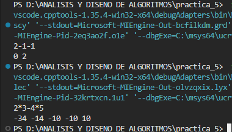
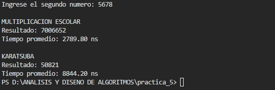
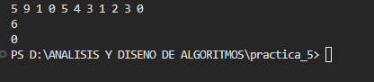
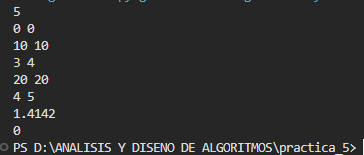
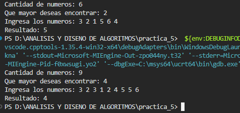

# Problemas de Divide y Vencerás
Presentado por : Quisocala Cruz Claudia Roxana

## Ejercicio 1. Formas de poner paréntesis

**Archivo:** `ejercicio_1.cpp`

### Enunciado

Dada una expresión con enteros y los operadores `+`, `-` y `*`, calcule todos los resultados que se obtienen al agrupar la expresión con paréntesis de todas las formas posibles. Divida la expresión en cada operador, resuelva recursivamente la parte izquierda y la derecha, y combine cada resultado de la izquierda con cada resultado de la derecha.

- **Entrada:** Una línea con la expresión, de 1 a 20 caracteres, sin espacios. Los números están entre 0 y 99.
- **Salida:** Todos los resultados en orden ascendente, incluyendo repetidos, separados por espacios.

### Resultados obtenidos

```text
Entrada:  2-1-1
Salida:   0 2

Entrada:  2*3-4*5
Salida:   -34 -14 -10 -10 10
```

**T(n):** Crecimiento exponencial para obtener las combinaciones; **Θ(R²)** para ordenar los `R` resultados con Selection Sort.

### Captura de ejecución

**Nombre:** `ejercicio_1.png`



---

## Ejercicio 2. Multiplicación de enteros grandes

**Archivo:** `ejercicio_2.cpp`

### Enunciado

Dados dos enteros no negativos representados como cadenas de dígitos, calcule su producto como cadena. No se permite convertir las cadenas a tipos numéricos del lenguaje ni usar bibliotecas de enteros grandes. Implemente el algoritmo de Karatsuba y compare su tiempo con la multiplicación escolar para entradas de **10³ y 10⁴ dígitos**.

- **Entrada:** Dos líneas, cada una con un entero de 1 a 10⁴ dígitos, sin ceros a la izquierda salvo el número 0.
- **Salida:** El producto, sin ceros a la izquierda.

### Resultado obtenido

```text
Entrada:
1234
5678

Multiplicación escolar:
Resultado: 7006652
Tiempo promedio: 98.94 ns

Karatsuba:
Resultado: 50821
Tiempo promedio: 653.41 ns
```

**T(n):** Multiplicación escolar: **Θ(n²)**. Karatsuba: **3T(n/2) + Θ(n) = Θ(n^1.585)**.

### Captura de ejecución

**Nombre:** `ejercicio_2.png`



---

## Ejercicio 3. Conteo de intercambios

**Archivo:** `ejercicio_3.cpp`

### Enunciado

Una secuencia de enteros distintos se ordena de forma ascendente intercambiando solo elementos adyacentes. Calcule el número mínimo de intercambios necesarios, que es igual al número de pares `(i, j)` con `i < j` y `a[i] > a[j]`. La solución debe ser **Θ(n lg n)**.

- **Entrada:** Varios casos. Cada caso empieza con `n` (`n ≤ 500 000`) seguido de `n` enteros, uno por línea, entre 0 y 999 999 999. La entrada termina con `n = 0`.
- **Salida:** Para cada caso, el número mínimo de intercambios.

### Resultado obtenido

```text
Entrada:
5
9
1
0
5
4
3
1
2
3
0

Salida:
6
0
```

**T(n):** `2T(n/2) + Θ(n) = Θ(n log n)`.

### Captura de ejecución

**Nombre:** `ejercicio_3.png`



---

## Ejercicio 4. Par de puntos más cercano

**Archivo:** `ejercicio_4.cpp`

### Enunciado

Dado un conjunto de puntos en el plano, encuentre la distancia euclidiana entre los dos puntos más cercanos. La solución debe ser **Θ(n lg n)**: dividir por la coordenada `x`, resolver cada mitad y revisar la franja central.

- **Entrada:** Varios casos. Cada caso empieza con `n` (`0 ≤ n ≤ 10 000`) seguido de `n` líneas con las coordenadas `x, y` de cada punto, entre 0 y 40 000. La entrada termina con `n = 0`.
- **Salida:** Para cada caso, la distancia mínima con 4 decimales. Si `n = 1` o la distancia es mayor o igual a 10 000, imprima `INFINITY`.

### Resultado del ejemplo

```text
Entrada:
5
0 0
10 10
3 4
20 20
4 5
1
7 7
0

Salida:
1.4142
INFINITY
```

**T(n):** `2T(n/2) + Θ(n) = Θ(n log n)`.

### Captura de ejecución

**Nombre:** `ejercicio_4.png`



---

## Ejercicio 5. k-ésimo elemento más grande

**Archivo:** `ejercicio_5.cpp`

### Enunciado

Dado un arreglo de enteros y un entero `k`, devuelva el k-ésimo elemento más grande en el orden ordenado, contando repetidos. No se permite ordenar el arreglo. Implemente **Quickselect** con pivote aleatorio, de tiempo esperado **Θ(n)**.

- **Entrada:** Una línea con `n` y `k` (`1 ≤ k ≤ n ≤ 10⁵`) y una línea con `n` enteros entre −10⁴ y 10⁴.
- **Salida:** El k-ésimo elemento más grande.

### Resultados obtenidos

```text
Entrada:
6 2
3 2 1 5 6 4

Resultado: 5

Entrada:
9 4
3 2 3 1 2 4 5 5 6

Resultado: 4
```

**T(n):** **Θ(n)** en promedio; **O(n²)** en el peor caso.

### Captura de ejecución

**Nombre:** `ejercicio_5.png`



